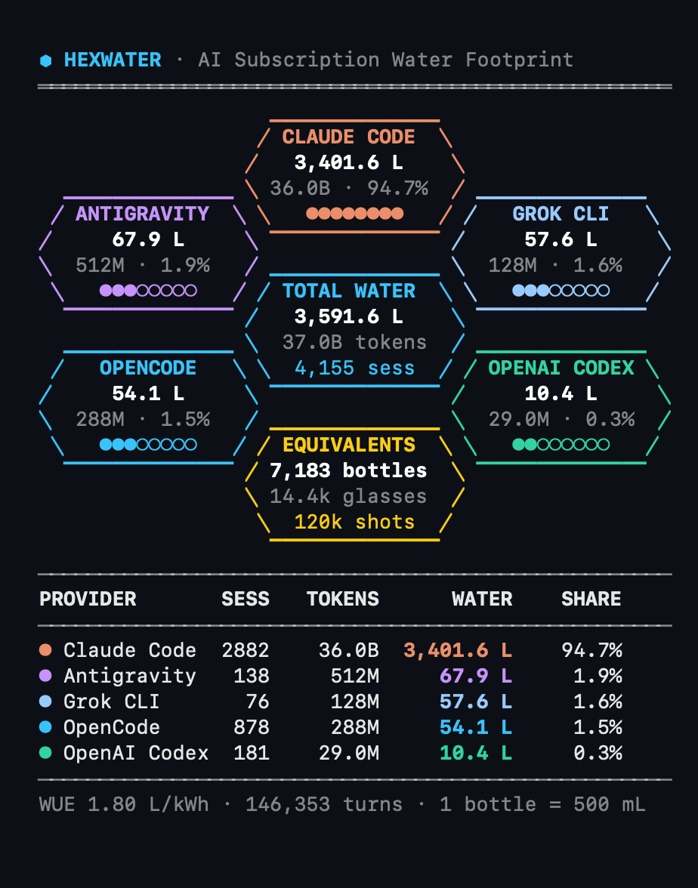

# ⬢ hexwater

Terminal honeycomb water-footprint analyzer for local AI coding subscriptions (**Claude Code**, **Antigravity**, **Grok CLI**, **OpenCode**, and **OpenAI Codex**).



## Quick Run (zero install)

`hexwater` is a valid **Bash + Python 3 polyglot**, so you can pipe it straight to `bash` (using the release asset URL so GitHub counts every run):

```bash
curl -fsSL https://github.com/M0xoo/hexwater/releases/latest/download/hexwater | bash
```

Pass CLI flags via `bash -s --`:

```bash
curl -fsSL https://github.com/M0xoo/hexwater/releases/latest/download/hexwater | bash -s -- --json
```

## Install to `~/.local/bin/hexwater`

```bash
curl -fsSL https://github.com/M0xoo/hexwater/releases/latest/download/install.sh | bash
```

Then run anytime from your terminal:

```bash
hexwater
```

Check how many times Method 1 (`curl | bash`) vs Method 2 (`install.sh`) has been used:

```bash
hexwater --stats
```

## Supported Local Telemetry Stores

All scanning is 100% local and read-only (no API keys or network calls):

| Subscription | Local Path | Extracted Telemetry |
|---|---|---|
| **Claude Code** | `~/.claude/projects/**/*.jsonl` | `usage.{input,output,cache_read,cache_creation}_tokens` |
| **Antigravity** | `~/.gemini/antigravity-cli/brain/**/transcript.jsonl` | `input_tokens`, `output_tokens`, `cache_read_tokens` |
| **Grok CLI** | `~/.grok/sessions/**/usage.json` | `session.{input,output,reasoning,cachedRead,cacheCreation}Tokens` |
| **OpenCode** | `~/.local/share/opencode/opencode.db` | `message.data -> $.tokens.{input,output,reasoning,cache}` |
| **OpenAI Codex** | `~/.codex/state_5.sqlite` | `threads.tokens_used` |

## Flags

- `--wue <float>` — Combined Scope 1+2 Water Usage Effectiveness in L/kWh (default: `1.8`)
- `--json` — Output machine-readable JSON
- `--no-color` — Disable 24-bit ANSI colors
- `--no-cache` — Bypass `~/.cache/hexwater/token_cache_v1.json`
